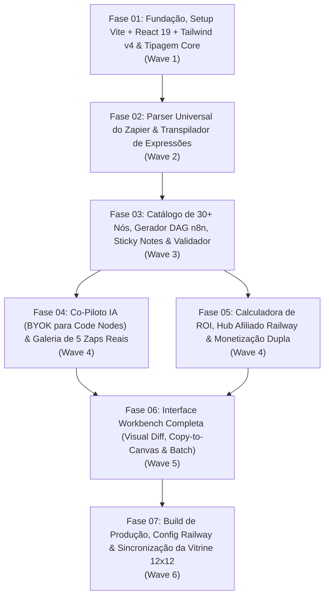

# Roadmap de Execução — ZapFlow (05-zapier-to-n8n)

> **Princípio GSD (Get Shit Done):** Cada fase é autossuficiente, orientada a objetivos verificáveis (*Goal-Backward Planning*) e possui um plano executável detalhado (`XX-01-PLAN.md`) com especificações completas de arquivos, interfaces, algoritmos e comandos de validação.

---

## Visão Geral das Fases (Waves)

| Fase | Diretório da Fase | Wave | Requisitos Cobertos | Status |
| :--- | :--- | :---: | :--- | :---: |
| **Fase 01** | `.planning/phases/01-foundation-and-models/` | Wave 1 | `REQ-DEP-01`, `REQ-GEN-01` (Tipos/Catálogo Base) | ✅ Concluído |
| **Fase 02** | `.planning/phases/02-parser-and-expression-engine/` | Wave 2 | `REQ-PRS-01`, `REQ-PRS-02`, `REQ-PRS-03`, `REQ-EXP-01`, `REQ-EXP-02`, `REQ-EXP-03` | ✅ Concluído |
| **Fase 03** | `.planning/phases/03-n8n-generator-and-validator/` | Wave 3 | `REQ-GEN-01`, `REQ-GEN-02`, `REQ-GEN-03`, `REQ-GEN-04`, `REQ-GEN-05` | ✅ Concluído |
| **Fase 04** | `.planning/phases/04-ai-code-copilot-and-samples/` | Wave 4 | `REQ-PRS-04`, `REQ-AIC-01` | ✅ Concluído |
| **Fase 05** | `.planning/phases/05-railway-affiliate-and-roi-engine/` | Wave 4 | `REQ-MON-01`, `REQ-MON-02`, `REQ-MON-03` | ✅ Concluído |
| **Fase 06** | `.planning/phases/06-interactive-workbench-ui/` | Wave 5 | `REQ-UI-01` | ✅ Concluído |
| **Fase 07** | `.planning/phases/07-deploy-and-showcase-sync/` | Wave 6 | `REQ-DEP-01` + Vitrine `00-desafio-12x12` | ✅ Concluído |

---

## Detalhamento das Fases

### Fase 01: Fundação, Setup Vite + React 19 + Tailwind v4 & Tipagem Core (`01-foundation-and-models`)
- **Objetivo:** Inicializar o projeto em `05-zapier-to-n8n` com Vite, React 19, TypeScript estrito, Tailwind CSS v4 e Lucide React; configurar `base: './'` no `vite.config.ts` e `railway.json`; definir todas as interfaces de domínio (`src/types/index.ts`), configurações padrão de preços/afiliados (`src/constants/defaults.ts`), catálogo completo de mapeamento de nós (`src/constants/nodeMappings.ts`) e persistência local (`src/services/storageService.ts`).
- **Plano:** `.planning/phases/01-foundation-and-models/01-01-PLAN.md`

### Fase 02: Parser Universal do Zapier & Transpilador de Expressões (`02-parser-and-expression-engine`)
- **Objetivo:** Construir o `src/services/zapierParser.ts` capaz de ler exports individuais, lotes (`zaps: [...]`) e blueprints do Zapier, normalizando gatilhos, ações, filtros e ramificações (`Paths`); e construir o `src/services/expressionTranspiler.ts` que converte tokens `{{step__field}}` e metadados do Zapier para a sintaxe `={{ $json.field }}` e `={{ $('NodeName').item.json.field }}` do n8n.
- **Plano:** `.planning/phases/02-parser-and-expression-engine/02-01-PLAN.md`

### Fase 03: Catálogo de 30+ Nós, Gerador DAG n8n, Sticky Notes & Validador (`03-n8n-generator-and-validator`)
- **Objetivo:** Construir o `src/services/n8nGenerator.ts` que transforma cada Zap normalizado em um workflow JSON oficial do n8n com cálculo geométrico de coordenadas `[x, y]`, conexões multi-saída (`If`/`Switch`), geração de `Sticky Note` de documentação no canvas e fallback inteligente para HTTP Request; e construir o `src/services/n8nValidator.ts` que audita o JSON gerado, calcula o Score de Confiança (0-100%) e lista as credenciais necessárias.
- **Plano:** `.planning/phases/03-n8n-generator-and-validator/03-01-PLAN.md`

### Fase 04: Co-Piloto IA (BYOK para Code Nodes) & Galeria de 5 Zaps Reais (`04-ai-code-copilot-and-samples`)
- **Objetivo:** Construir o `src/services/aiCopilotService.ts` com transpilador heurístico local de JS/Python (`inputData` $\rightarrow$ `$input.all()`) e integração opcional BYOK com Groq, OpenAI e Anthropic Claude; e criar `src/constants/sampleZaps.ts` contendo 5 Zaps reais completos (incluindo um pacote de agência com 4 Zaps em lote) para demonstração imediata em 1 clique.
- **Plano:** `.planning/phases/04-ai-code-copilot-and-samples/04-01-PLAN.md`

### Fase 05: Calculadora de ROI, Hub Afiliado Railway & Monetização Dupla (`05-railway-affiliate-and-roi-engine`)
- **Objetivo:** Construir o `src/services/roiCalculatorService.ts` que compara custos reais por faixa de tarefas do Zapier vs. n8n Self-Hosted na Railway (~$5/mês) em USD e BRL, gerando links de afiliado parametrizados (`?referralCode=...`) e controle de licença Pro (`R$ 59` vitalício para lotes/white-label) com validação de cupons promocionais.
- **Plano:** `.planning/phases/05-railway-affiliate-and-roi-engine/05-01-PLAN.md`

### Fase 06: Interface Workbench Completa (`06-interactive-workbench-ui`)
- **Objetivo:** Construir o `MigrationContext.tsx` e todos os componentes visuais modernos em Dark Mode (`Header`, `UploadDropzone`, `VisualFlowDiff`, `CodeInspector`, `MigrationReportCard`, `RoiAffiliateBanner`, `AiCopilotModal`, `PaywallModal`), integrando-os no `App.tsx` com suporte a colagem direta (`Ctrl+V`) no canvas do n8n.
- **Plano:** `.planning/phases/06-interactive-workbench-ui/06-01-PLAN.md`

### Fase 07: Build de Produção, Config Railway & Sincronização da Vitrine 12x12 (`07-deploy-and-showcase-sync`)
- **Objetivo:** Validar TypeScript e build de produção (`npm run build`), testar o fluxo ponta a ponta dos 5 Zaps de exemplo e da conversão em lote, documentar o `README.md` do projeto e atualizar os arquivos da vitrine central (`00-desafio-12x12/index.html`, `00-desafio-12x12/README.md` e `AGENTS.md`).
- **Plano:** `.planning/phases/07-deploy-and-showcase-sync/07-01-PLAN.md`
