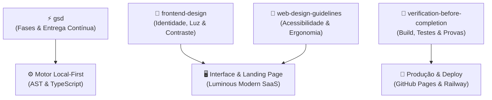

# 🎨 Guia de Design & Boas Práticas: Playbook ZapFlow (Desafio 12x12)

Este documento documenta o processo de design, arquitetura e uso das **Skills** do ecossistema de agentes que transformaram o **ZapFlow** em uma aplicação web com acabamento profissional, alta conversão e excelência técnica.

Use este guia como **modelo de referência obrigatório** para os próximos projetos do **Desafio 12 Projetos em 12 Semanas**.

---

## 🧭 Visão Geral: A Virada de Chave (Antes vs. Depois)

| Dimensão | Versão Inicial (Comum / "AI-Slop") | Versão Final (Refinada com as Skills) |
| :--- | :--- | :--- |
| **Paleta de Cores** | Fundo preto breu (`#020617` / `#08090d`), badges neon com contraste confuso | Fundo luminoso (`#f8fafc` Slate-50), cartões brancos nítidos (`#ffffff`) com bordas suaves (`border-slate-200`) |
| **Tipografia** | Texto cinza escuro sobre fundo preto (difícil de ler) | Texto em Slate-950/Slate-900 (100% legível, padrão WCAG AAA) com hierarquia nítida |
| **Entrada do Usuário** | Tela direta cheia de caixas técnicas sem contexto | **Landing Page acolhedora** com narrativa clara, 3 passos visuais, calculadora real e botão "Usar Grátis" |
| **Monetização** | Banners agressivos de venda no rodapé poluindo a tela | **Drawer lateral discreto** + Botão nativo prestativo *"Ainda não tem seu n8n hospedado? Criar com 1 clique"* |
| **Calculadora** | Slider genérico até 1.5M com números irreais | **Tabela oficial de preços do Zapier** com botões de 1 clique nos 8 patamares oficiais (750 a 100k) |

---

## 🛠️ Como Cada Skill Foi Utilizada

---

### 1. Skill `frontend-design` (Identidade Visual e Anti-Padrões de IA)

A skill `frontend-design` proíbe o que chama de *"AI-generated tells"* — características genéricas que inteligências artificiais costumam gerar se não forem instruídas com rigor.

#### Regras aplicadas:
1. **Evitar o "Dark Mode Cavernoso":**
   - *O Erro:* Telas 100% pretas com textos apagados geram fadiga visual e passam a sensação de aplicativo inacabado ou hacker tool confuso.
   - *A Solução:* Adotar uma estética **Luminous SaaS** (inspirada em Stripe, Vercel e Linear Light Docs):
     - Background geral: `bg-slate-50` (`#f8fafc`)
     - Superfícies de cartões: `bg-white` com `border border-slate-200 shadow-sm`
     - Texto primário: `text-slate-900` / `text-slate-950`
     - Texto de apoio: `text-slate-600`
2. **"Spend Boldness in One Place" (Disciplinar o Uso de Cores):**
   - Não pulverize 10 cores diferentes em todo lugar. Escolha **uma cor principal de ação** e reserve-a para os momentos cruciais.
   - **Laranja/Coral Vibrante (`#ea580c` / `#ea4b71`):** Ação primária (*"Copiar para n8n"*, *"Usar Grátis Agora"*).
   - **Índigo / Nuvem (`#4f46e5`):** Ação de infraestrutura (*"Ainda não tem seu n8n hospedado? Criar com 1 clique"*).
   - **Esmeralda (`#10b981`):** Economia líquida e validação de testes.
3. **Copywriting com Propósito (Sem Jargões Vazios):**
   - Em vez de rótulos genéricos como *"Configurações de Webhook e Payload"*, usamos frases orientadas ao objetivo do usuário:
     - *"💡 Como colar no n8n: clique em Copiar, vá ao n8n e aperte Ctrl+V. Os nós aparecem conectados na hora!"*

---

### 2. Skill `web-design-guidelines` (UX, Acessibilidade & Ergonomia)

Garante que o design não seja apenas bonito, mas altamente funcional, intuitivo e acessível.

#### Boas práticas implementadas:
1. **Atalhos Visuais com `<kbd>`:**
   - Uso de tags semânticas `<kbd className="px-1.5 py-0.5 bg-slate-200 text-slate-800 rounded font-mono text-xs font-semibold">Ctrl+V</kbd>` para sinalizar comandos de teclado com clareza imediata.
2. **Affordance e Feedback Instantâneo:**
   - Botões mudam de estado de forma explícita: ao clicar em *"Copiar para n8n"*, o botão muda temporariamente para verde esmeralda com o ícone de Check e o texto *"Copiado! Aperte Ctrl+V no n8n"*, retornando suavemente após 2.4s.
3. **Navegação Não-Destrutiva com 2 Visões:**
   - A Landing Page funciona como tela de entrada. Quando o usuário clica em *"Usar Grátis Agora"*, o Migrador abre em tela cheia, com um botão claro `← Início` no cabeçalho superior para voltar à apresentação sem perder os arquivos carregados.
4. **Cards com Target Clicável Generoso:**
   - Zaps carregados do arquivo ZIP viram cartões espaçosos com ícone colorido da ferramenta (Zoom, Gmail, Stripe, Webhook), contagem de nós e badge de status.

---

### 3. Engenharia de Monetização Não-Invasiva (Native 1-Click Hosting)

Uma das maiores lições deste projeto foi a **transformação da monetização**:
- *Abordagem Ruim:* Banners piscando "Compre meu plano Pro", "Link de afiliado", popups chatos de paywall.
- *Abordagem de Alta Conversão:* Oferecer uma **solução real para o próximo passo natural do usuário**.
  - O usuário está migrando do Zapier para o n8n.
  - O que ele precisa imediatamente para rodar o fluxo que acabou de copiar? **De um n8n funcionando na nuvem.**
  - A mensagem foi colocada em tom de ajuda direta:
    > *"Ainda não tem seu n8n hospedado? Tenha seu servidor dedicado com PostgreSQL em 2 minutos por ~$5/mês sem limite de tarefas. [Criar com 1 clique ↗]"*
  - O link leva direto para o template configurado do Railway (`https://railway.com/deploy/n8n-main-worker?referralCode=mdYrO9`), sem fricção e sem soar como anúncio.

---

### 4. Skill `gsd` (Get Shit Done - Fases Ágeis de Execução)

A aplicação foi desenvolvida em fases atômicas com validação contínua:

1. **Fase 1 (AST Engine):** Parser tolerante a falhas capaz de ler tanto arquivos `.json` individuais quanto pacotes `.zip` completos contendo dezenas de fluxos.
2. **Fase 2 (Transpiler):** Expressões de interpolação do Zapier (`{{step__param}}`, `{{zap_meta_human_now}}`) convertidas dinamicamente para o padrão `$json.param` e `$now` do n8n v1.
3. **Fase 3 (Multi-Branch Graph):** Suporte a filtros condicionais e blocos de decisão (*Paths*) mapeados para nós `n8n-nodes-base.switch` com múltiplas saídas DAG.
4. **Fase 4 (Interface Studio):** Workbench com abas: *Fluxo Visual*, *JSON do n8n* e *Checklist de Migração*.
5. **Fase 5 (Calculadora de ROI):** Simulação matemática com preços reais do Zapier e Railway.
6. **Fase 6 (Refinamento Visual):** Transição do tema escuro para a Landing Page luminosa e de alto contraste.
7. **Fase 7 (Deploy e Vitrine):** Build estático, deploy no GitHub Pages e atualização da vitrine oficial.

---

### 5. Skill `verification-before-completion` (Evidência Antes de Afirmação)

A regra de ouro mais importante: **nunca afirmar que um código funciona sem rodar comandos e inspecionar a saída**.

- **TypeScript:** Sempre rodar `/usr/local/bin/node ./node_modules/typescript/bin/tsc -p tsconfig.app.json --noEmit` até obter 0 erros.
- **Vite Build:** Compilar a pasta `dist/` com `/usr/local/bin/node ./node_modules/vite/bin/vite.js build`.
- **Testes Automatizados:** Manter um script de teste E2E (`scripts/verify-engine.ts`) que testa todos os cenários sem depender de cliques manuais.
- **Teste com Dados Reais:** Testar a extração com o arquivo `.zip` real fornecido pelo usuário.

---

## 📋 Checklist Rápido para os Próximos Projetos (Copie e Cole)

Ao iniciar qualquer projeto da lista (Projetos 06 a 12), garanta os seguintes pontos:

- [ ] **Configuração Base:** `base: './'` configurado no `vite.config.ts` para funcionar no GitHub Pages.
- [ ] **Zero Backend Obrigatório:** Computação pesada resolvida 100% no navegador (Canvas, Web Workers, AST puro).
- [ ] **Design Luminoso & Limpo:** Fundo `bg-slate-50`, cartões `bg-white border-slate-200`, texto escuro `text-slate-900`.
- [ ] **Landing Page de Entrada:** Explicação clara da dor, demonstração em 3 passos, CTAs visíveis e seção de FAQ.
- [ ] **Favicon com Identidade:** Arquivo `public/favicon.svg` com ícone vetorial da marca e tags no `<head>`.
- [ ] **Monetização Construtiva:** Se houver afiliado ou infraestrutura recomendada, posicione como utilitário de 1 clique.
- [ ] **Verificação Rigorosa:** `tsc --noEmit` + `vite build` passando limpos antes de qualquer commit.
- [ ] **Sincronização da Vitrine:** Atualizar `00-desafio-12x12/index.html` e `00-desafio-12x12/README.md`.
